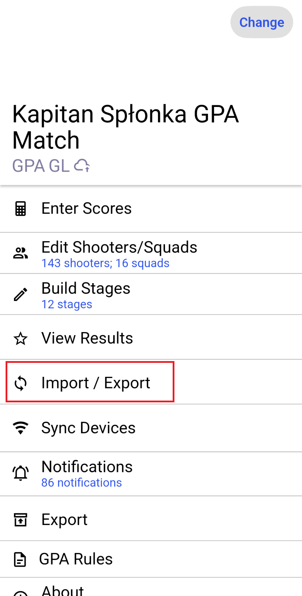
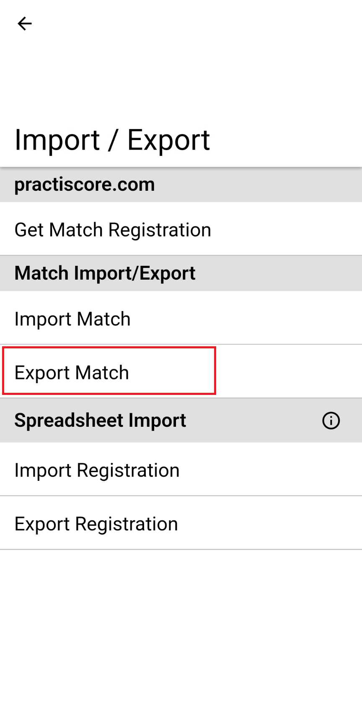

# PractiScore Diplomas Generator

Create one diploma document from a PractiScore match export. This guide walks through the normal workflow in the Windows graphical app. You can also use the command line if you prefer.

**Read this guide in:** English · [Polski](README.pl.md)

Start with the graphical workflow below, or go directly to [terminal use](#use-the-command-line), [award configuration](#award-configuration), [template fields](#prepare-a-diploma-template), or [troubleshooting](#troubleshooting).

## Create Diplomas In The Graphical App

You need three inputs: a final PractiScore export, a YAML award configuration from `configs` (or your own copy), and a DOCX/ODT template from `templates` (or your own design). [Download the latest Windows package](https://github.com/gliter/practiscore-diplomas-generator/releases/latest/download/practiscore-diplomas-generator-windows-x64.zip) and extract it before starting; Python and `uv` are not required.

### 1. Export the match

In PractiScore, finish and verify the match, then choose **Import / Export** → **Export Match**. Save the exported archive. The app accepts `.pcs`, `.psc`, and `.zip` files; all three are ZIP archives. An unpacked export directory is also supported when using the command line.

In PractiScore, the export is available in these two screens:





### 2. Choose the match, award configuration, and template

Double-click `practiscore-diplomas.exe`. The dropdowns list match archives from the working directory, configurations from `configs`, and DOCX/ODT templates from `templates`. Choose **Choose another file…** to browse elsewhere. Keep `configs` and `templates` beside the executable when using the packaged Windows app.

As soon as you choose a match, the app parses the shooter data and saves `shooters-summary-<match-name>.yaml` in the working directory. If a summary for that match already exists and differs from the fresh parse, the app shows both file paths and modification times. Choose **Data from .pcs** to use the new export or **Data from summary** to keep your edited summary. If both versions are identical, no prompt is shown.

Choose the award configuration and diploma template. The configuration determines who qualifies and what award series are created. The template controls the document layout. Diploma rows appear in the main table when the required inputs are available.

To edit a configuration in the app, select it and click **Edit**. Click **Apply** to validate and use the changes in memory; use **Save** or **Save as** to write them to a file. If you close the app with unsaved configuration changes, you can save, save as, discard, or cancel.

### 3. Review the shooters and diploma rows

Use **Edit shooter data** beside the match selector to review or correct shooter records. Changes are kept in the editor until you choose **Save changes**. Division and class use match-provided dropdown values; categories and penalties have dedicated editors. Calculated penalty seconds and total time are shown for reference. Modified cells are highlighted orange; closing with unsaved edits offers save, discard, or cancel. Saving the shooter summary updates the YAML file and regenerates diploma data. If diploma rows were manually edited, the app asks whether to discard those edits before recalculating.

Review the diploma table before generating the document:

- Double-click a cell to edit it. The red **×** removes a row after confirmation; the blue switch icon changes its shooter. The pencil icon opens the shooter editor with that shooter selected by UID. Use **New row…** to choose a shooter and add a diploma; the new row starts with place 1, an empty series, and empty diploma text and metric fields.
- Use the column headings to sort or filter. Filters can include multiple values, and a dot in a heading indicates an active filter.
- The shooter picker uses the same sortable and filterable table. Its search matches names, divisions, categories, and classes.
- Rows with a template-line error are highlighted red. The affected line shows a short `<błąd: ...>` message, while the other diplomas are still generated. Correct the configuration and recalculate, or replace the error text manually.

Changing shooter data or applying a configuration recalculates diplomas automatically if there are no manual diploma edits. Otherwise, you can confirm replacing the edits or keep them. If you keep them, **Regenerate diploma data** turns orange and the status bar indicates that the diplomas are out of date. Use that button when you are ready to regenerate; it replaces the manually edited rows. An enabled button has a prominent orange border. The button is disabled when there is nothing to recalculate.

Table filters help you review the rows; they do not exclude diplomas from the generated document. Remove unwanted rows or change the award configuration to change what is printed.

Within each series, groups are ordered from the largest eligible group to the smallest. Diplomas within a group are listed from the last awarded place to first place.

### 4. Generate the document

Choose **Generate diplomas…** to save the document, or **Generate diplomas and open** to save it and open it in your system's default application. Choose the output path and format in the save dialog. DOCX and ODT work directly; PDF and cross-format conversion require LibreOffice with `soffice` on `PATH`.

The app also keeps two review files in the working directory:

```text
shooters-summary-<match-name>.yaml
diplomas-data-<match-name>.yaml
```

Keep these files with the match records. The shooter summary contains raw shooter data plus `_match_options`, which stores the match's divisions, classes, categories, penalty values in seconds, and scoring options. Penalty seconds and total time are calculated for display and diploma generation. The summary is keyed by internal PractiScore UID; `shooter_id` is the separate visible GPA or IDPA competitor number.

The diploma-data YAML contains the generated award selections, grouped under `diplomas` by series, with place, grouping context, line text, ranking metric, and shooter details. In the GUI it is updated automatically after every committed cell edit, added or removed row, shooter switch, and recalculation. Reopening the match or restarting the app restores these saved diploma rows instead of overwriting them. The app compares the saved rows with diplomas calculated from the current shooter data and configuration. If they match, **Regenerate diploma data** is disabled. If they differ, a centered dialog shows the YAML path and lets you choose **Use saved data** or **Generate again**. Using saved data keeps your edits and highlights the button orange; generating again replaces the YAML with current awards and disables the button. Cancelling leaves the current match unchanged. You can generate a document directly from the restored rows. Regeneration asks for confirmation before replacing them with awards calculated from the current shooter data and configuration.

## Use The Command Line

The Windows package includes the GUI, an interactive terminal menu, and commands for automation. You do not need Python or `uv` to use the executable. Open PowerShell in the extracted package folder. All examples below use that folder as the working directory; quote paths that contain spaces.

### Interactive menu (`-I`)

```powershell
.\practiscore-diplomas.exe -I
```

Use the up/down arrows and Enter to choose a workflow:

| Menu option | When to use it |
| --- | --- |
| Render diplomas from a PractiScore file | Generate a document directly from a match archive and award configuration. |
| Parse a PractiScore file into YAML | Generate the shooter summary and diploma rows for review before rendering. |
| Render diplomas from diploma-data YAML | Render reviewed or manually edited diploma data, or use a different template without recalculating awards. |

The file pickers list match archives and YAML data from the working directory, configurations from `configs`, and DOCX/ODT templates from `templates`. **Choose file** opens the system file dialog; cancelling it returns to the list. When rendering, the save dialog lets you choose a filename and format. The output extension determines whether the result is DOCX, ODT, or PDF.

Double-clicking the executable or running it without arguments opens the GUI. Use `-I` on its own, optionally with `--language`; it cannot be combined with `parse` or `render`.

### Parse, review, then render

This workflow lets you change the selected diplomas before creating the document.

1. Generate the shooter summary and diploma data:

   ```powershell
   .\practiscore-diplomas.exe parse `
     -i "match-export.zip" `
     -c "configs\gpa_t1_config.yaml"
   ```

   Input can be a `.pcs`, `.psc`, or `.zip` archive, or an unpacked export directory containing `match_def.json` and `match_scores.json`.

2. Review `diplomas-data-<match-name>.yaml` in a text editor. You can change diploma text, correct a displayed name, or remove a diploma record. Preserve the YAML structure and indentation.
3. Render that reviewed file:

   ```powershell
   .\practiscore-diplomas.exe render `
     -d "diplomas-data-Example-Match.yaml" `
     -t "templates\example-diploma-template.docx" `
     -o "diplomas.docx"
   ```

`render -d` uses the supplied diploma records as they are. It does not parse the match or recalculate awards, and it does not accept `-c`. Keep the reviewed YAML to render it again later. Running `parse` or `render -i` again recreates diploma data from the export and configuration, replacing existing files at the output paths.

### Generate directly from a match

For a document that does not need manual changes to the diploma data:

```powershell
.\practiscore-diplomas.exe render `
  -i "match-export.zip" `
  -c "configs\gpa_t1_config.yaml" `
  -t "templates\example-diploma-template.docx" `
  --output-docx "diplomas.docx"
```

This parses the match, generates both review YAML files, and renders the document. To use an unpacked export, replace the input path with a directory, for example `-i "exports\example-match"`.

### Choose file paths and output format

By default, `parse` and `render -i` write these files in the working directory:

```text
shooters-summary-<match-name>.yaml
diplomas-data-<match-name>.yaml
```

The name comes from the match definition, with spaces replaced by hyphens and characters unsuitable for filenames replaced by underscores. `parse` lets you override both paths; parent directories are created as needed:

```powershell
.\practiscore-diplomas.exe parse `
  --input "match-export.zip" `
  --config "configs\gpa_t1_config.yaml" `
  --summary-output "results\shooters.yaml" `
  --diplomas-data "results\diplomas.yaml"
```

The two commands use these options:

| Option | `parse` | `render` |
| --- | --- | --- |
| `-i`, `--input PATH` | Required: archive or unpacked export. | Match input, as an alternative to `-d`. |
| `-c`, `--config PATH` | Required award configuration. | Required with `-i`; not accepted with `-d`. |
| `-s`, `--summary-output PATH` | Custom shooter-summary output. | Not available; direct match input uses the standard YAML filenames. |
| `-d`, `--diplomas-data PATH` | Custom diploma-data **output**. | Reviewed diploma-data **input**, as an alternative to `-i`. |
| `-t`, `--template PATH` | Not used. | Required DOCX or ODT template. |
| `-o`, `--output-docx [PATH]` | Not used. | Final DOCX document. |
| `--output-odt [PATH]` | Not used. | Final ODT document. |
| `--output-pdf [PATH]` | Not used. | Final PDF document; requires LibreOffice. |

`-o` is reserved for the final DOCX document. Choose at most one output option. Its path is optional: `--output-pdf` selects PDF with a default filename, while `--output-pdf "results\diplomas.pdf"` sets the path explicitly. Use an extension that matches the selected format.

If you omit all output options, the format follows the template. Default document names are `diplomas-<match-name>.docx` / `.odt` when using `render -i`, and `diplomas.docx` / `.odt` when using `render -d`. A format option without a path changes the extension accordingly. PDF and conversion between DOCX and ODT require LibreOffice with `soffice` or `libreoffice` on `PATH`; rendering DOCX to DOCX or ODT to ODT does not require it.

### Help and language

```powershell
.\practiscore-diplomas.exe --help
.\practiscore-diplomas.exe parse --help
.\practiscore-diplomas.exe render --help
.\practiscore-diplomas.exe --language en -I
.\practiscore-diplomas.exe render --language pl --help
```

Help follows the system locale. Override it with `--language en` or `--language pl`, before or after the subcommand. A PowerShell backtick at the end of a line continues the command on the next line; do not add spaces after it. You can also put each command on a single line.

### Run from source with uv

For source checkouts, install Python 3.10 or newer and `uv`, then run these commands from the repository folder:

```powershell
uv sync
uv run practiscore-diplomas
uv run practiscore-diplomas -I
```

The second command opens the GUI; the third opens the terminal menu. To use any CLI example above from source, replace `.\practiscore-diplomas.exe` with `uv run practiscore-diplomas`; the arguments are the same.

## Award Configuration

### Choose an example configuration

The `configs` folder contains example award rules:

| File | Intended use |
| --- | --- |
| `gpa_t1_config.yaml` | GPA Tier 1 matches. |
| `idpa_t1_config.yaml` | IDPA Tier 1 matches. |
| `idpa_t2_config.yaml` | IDPA Tier 2 matches. |

Start with the configuration closest to your match. Make a copy before changing it so the original example remains available.

The configuration controls award series, such as division winners, category winners, fastest competitor, and most accurate competitor. It also decides who is eligible. By default, the supplied configurations exclude DQ and DNF competitors. A failed Chrono check is treated as DNF unless the configuration changes that setting.

### Common Configuration Changes

You may need to edit the configuration if your match uses different divisions, categories, award counts, or wording. The main concepts are:

| Setting | Meaning |
| --- | --- |
| `series` | The award series to create. Each named entry becomes a separate ranking. |
| `type` | `best_shooter`, `most_accurate`, or `fastest`. |
| `group_by` | Split the ranking by `division`, `class`, or `category`. |
| `min_competitors` | Number of competitors required for each additional diploma. `[1, 6, 11]` gives 1 diploma for 1-5 people, 2 for 6-10, and 3 for 11 or more. |
| `filters` | Include or exclude divisions, categories, or classes. Patterns are regular expressions. |
| `text` | The lines printed on the diploma. |

If a configuration error appears, check quotation marks, indentation, and the spelling of division/category names. YAML indentation matters: use spaces, not tabs.

## Configuration Reference

Configuration files use YAML. Start by copying the closest example from `configs`, then edit the copy in a text editor. Keep the indentation consistent: use spaces, never the Tab key.

The main parts of a configuration are:

```yaml
exclude_shooters:
  surnames: []
  ids: []
mark_chrono_failure_as_dnf: true
maps: {}
series: {}
```

### Award Series

Each entry under `series` describes one kind of diploma. The entry name is only an internal label, so choose a short, meaningful name. This example creates division awards:

```yaml
series:
  best_in_division:
    type: best_shooter
    group_by: [division]
    min_competitors: [1, 6, 11]
    text:
      first_line: "{{ division }} DIVISION"
      second_line: "{{ place }} PLACE"
```

| Setting | What it controls |
| --- | --- |
| `type` | Ranking method: `best_shooter` selects the best overall result, `most_accurate` selects the lowest points-down result including steel misses converted using the match scoring options, and `fastest` selects the lowest raw time. |
| `group_by` | Creates separate rankings for each listed value: `division`, `class`, and/or `category`. Leave it out for one ranking covering everyone. |
| `min_competitors` | Award thresholds. `[1, 6, 11]` gives one diploma for 1-5 eligible people, two for 6-10, and three from 11 onward. `[5]` gives no diploma below 5 people and one from 5 onward. |
| `exclude_dq` | When `true`, DQ competitors cannot receive this award. The default is `true`. |
| `exclude_dnf` | When `true`, DNF competitors cannot receive this award. The default is `true`. |
| `ineligible_penalties` | A list of penalty names that make a competitor ineligible for this one series. Use the penalty name exactly as it appears in the export. |

Every series needs `type`, `min_competitors`, `text.first_line`, and `text.second_line`. `group_by`, filters, penalty rules, and the third and fourth text line are optional.

Thresholds must be strictly increasing non-negative integers, with at most five entries. Include `1` when a group with no eligible shooters should produce no diploma.

### Filters

Filters limit a series to selected divisions, categories, or classes. They use regular expressions. A pattern is matched against the complete PractiScore value, so use `.*` when the registration text continues after the code.

```yaml
filters:
  divisions:
    include: ["CPI.*", "CPO.*"]
  categories:
    exclude: ["Lady.*"]
```

The example includes divisions whose registration name begins with `CPI` or `CPO`, while excluding the Lady category. The available filter groups are `divisions`, `categories`, and `classes`.

| Form | Meaning |
| --- | --- |
| Omit `filters` or a filter group | Include all values. |
| `include` | Include only values matching at least one listed pattern. |
| `exclude` | Exclude values matching a listed pattern. Exclusion takes priority over inclusion. |
| A simple list, such as `divisions: ["CPI.*"]` | Short form of `include`. |

Use `"*"` in an include list to match all values. Omitting `include` also includes all values; omitting `exclude` excludes none.

### Maps And Diploma Line Text

Maps turn a value from PractiScore into the shorter wording printed on a diploma. They are especially useful when a division or category contains registration details that should not appear in the title.

```yaml
maps:
  division_code:
    "CPI.*": CPI
    "CPO.*": CPO
  division_place:
    1: CHAMPION
    2: 2nd PLACE
    3: 3rd PLACE
```

The program checks map entries from top to bottom and uses the first matching entry. Put more specific patterns before general ones. Quote text patterns such as `"CPI.*"`; numeric keys, such as places, do not need quotes.

The `text` section defines up to four lines for each diploma. The first two are required; the third and fourth are optional.

```yaml
text:
  first_line: "{{ division_code(division) }} DIVISION"
  second_line: "{{ division_place(place) }}"
  third_line: "{{ shooter.raw_time }} s"
  fourth_line: "{{ shooter.points_down }} PD"
```

Use `{{ field }}` to insert a value, and `{{ map_name(field) }}` to use a map. The following values can be used in diploma lines:

| Value | Meaning |
| --- | --- |
| `division`, `category`, `class` | The value that defines the current award group. |
| `place` | Place in the award ranking. |
| `type` | Award type: `best_shooter`, `most_accurate`, or `fastest`. |
| `shooter.shooter_id` | Visible GPA or IDPA competitor number. |
| `shooter.first_name`, `shooter.last_name` | Competitor name. |
| `shooter.division`, `shooter.categories`, `shooter.class` | Values recorded for the competitor in PractiScore. |
| `shooter.raw_time`, `shooter.points_down`, `shooter.steel_misses`, `shooter.penalty_seconds`, `shooter.total_time` | Result values. |
| `shooter.dnf`, `shooter.chrono_failure`, `shooter.dq`, `shooter.shooter_uid` | Competitor status, separate Chrono check result, and internal identifier. |

These YAML text lines provide `first_line` through `fourth_line` to the document template. The placeholders in the DOCX or ODT template are described in the next section; map calls are used in the configuration, not directly in the document template.

### Excluding Specific Shooters And Chrono Failures

Use `exclude_shooters` to remove non-competitors, test records, or a PAR-time record from every award series. `surnames` and `ids` are regular-expression lists; either list can be empty.

```yaml
exclude_shooters:
  surnames: ["(?i)^par$"]
  ids: []
```

`chrono_failure` in the summary records a gear check on a Chrono stage that was not marked Pass. It is independent of `dnf`. During diploma data generation, `mark_chrono_failure_as_dnf: true` (the default) treats this as DNF; `false` allows the shooter to remain eligible. The parser itself does not require an award configuration. The CLI `parse` command requires one because it also generates diploma data.

## Prepare A Diploma Template

Use a DOCX or ODT file as the template. Put placeholders where changing text should appear, for example:

```text
{{ first_line }}
{{ second_line }}
{{ shooter.first_name }} {{ shooter.last_name }}
```

The program makes one copy of the template for each diploma and preserves its paragraph and table formatting. The package includes `templates/example-diploma-template.docx` and `templates/example-diploma-template.odt`.

### Template Fields

| Field | Meaning |
| --- | --- |
| `first_line` | First line defined by the award configuration. |
| `second_line` | Second line defined by the award configuration. |
| `third_line` | Optional third line. Empty when the series does not define it. |
| `fourth_line` | Optional fourth line. Empty when the series does not define it. |
| `place` | Competitor's place in that award ranking. |
| `division` | Division used for the award. |
| `category` | Category used for the award. |
| `class` | Class used for the award. |
| `metric_value` | Ranking value, for example time or points down. |
| `shooter.shooter_id` | Visible GPA or IDPA competitor number. |
| `shooter.first_name` | Competitor's first name. |
| `shooter.last_name` | Competitor's last name. |
| `shooter.division` | Division recorded in PractiScore. |
| `shooter.categories` | Categories, shown as comma-separated text. |
| `shooter.class` | Class recorded in PractiScore. |
| `shooter.raw_time` | Total raw time before penalties. |
| `shooter.points_down` | Total points-down count. |
| `shooter.steel_misses` | Total missed steel targets. |
| `shooter.penalty_seconds` | Time added for penalties. |
| `shooter.total_time` | Raw time plus penalties. |
| `shooter.dnf` | `True` when the competitor is DNF. |
| `shooter.chrono_failure` | `True` when a Chrono gear check was not marked Pass. |
| `shooter.dq` | `True` when the competitor is DQ. |
| `shooter.shooter_uid` | Internal PractiScore identifier. Usually not needed on a diploma. |

Use the exact spelling and braces shown above. An unknown placeholder in the DOCX/ODT template stops document rendering with an error. A bad field or map in a configured diploma line is shown in that diploma row during review.

## Output Formats

| Format | Use |
| --- | --- |
| DOCX | Best when you want to edit the generated document. |
| ODT | Use with an ODT template or when you need an editable ODT document. |
| PDF | Requires LibreOffice with `soffice` available on `PATH`. |

## Troubleshooting

| Problem | What to check |
| --- | --- |
| A match file is not listed | Confirm that it is a `.pcs`, `.psc`, or `.zip` export, or use **Choose file**. |
| No diploma was created for a division or category | Check the configuration's filters, `min_competitors`, and DNF/DQ rules. |
| A competitor is unexpectedly DNF | Check whether every stage has a score and whether Chrono was passed. |
| A placeholder causes an error | Check its spelling against the Template Fields table. |
| PDF output fails | Install LibreOffice and ensure `soffice` is available on `PATH`. |
| Text is not positioned correctly | Adjust the paragraph or table formatting in the template, then render again. |

## Remembered Settings

The app remembers window settings, last selected input paths, and table layout, sorting, and filters in `%APPDATA%\PractiScore Diplomas\settings.json` on Windows. Shooter and configuration edits still need their respective save controls; committed diploma-table edits are stored separately in the diploma-data YAML.
